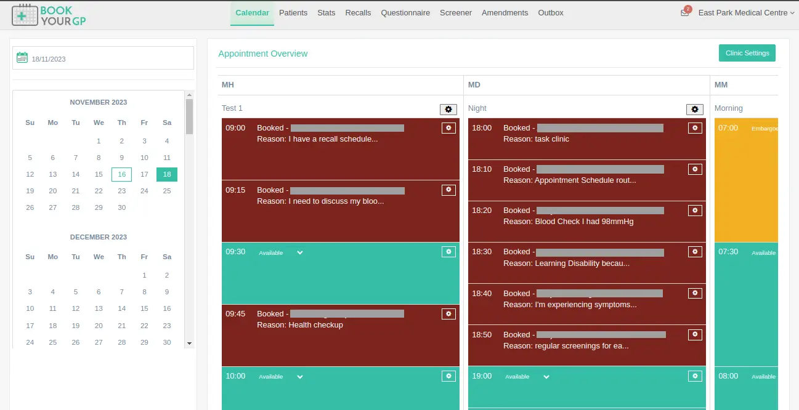

## Problem

- The existing legacy PHP system supported core appointment, recall, and patient communication workflows, but became harder to maintain, extend, and scale over time.
- Performance bottlenecks in database queries and legacy implementation patterns affected responsiveness during real clinic usage.
- The product needed modernization and essential improvements such as better performance, translation support, and support for imported-file inputs while preserving production stability.

## My Role

- Full Stack Developer contributing as one of two engineers on the modernization from legacy PHP to Laravel.
- Focused on backend development, SQL performance optimization, production stability, and communication workflow integrations.

## What I Built

- Migrated and refactored core backend functionality from legacy PHP to Laravel while keeping existing clinical workflows stable.
- Optimized SQL queries and added database indexes to improve system responsiveness.
- Extended existing workflows with essential improvements such as translation support and imported-file input handling.
- Improved patient communication integrations using GOV.UK Notify and Twilio for recall and appointment-related messaging.
- Maintained and enhanced existing appointment, recall, and follow-up workflows without disrupting live clinic operations.

## Outcome

- Reduced page load times by 60–75% through SQL optimization and database indexing.
- Improved maintainability and scalability by modernizing the backend architecture with Laravel.
- Reduced missed appointments and improved follow-up reliability by strengthening automated reminders, recall notifications, and patient communication workflows.
