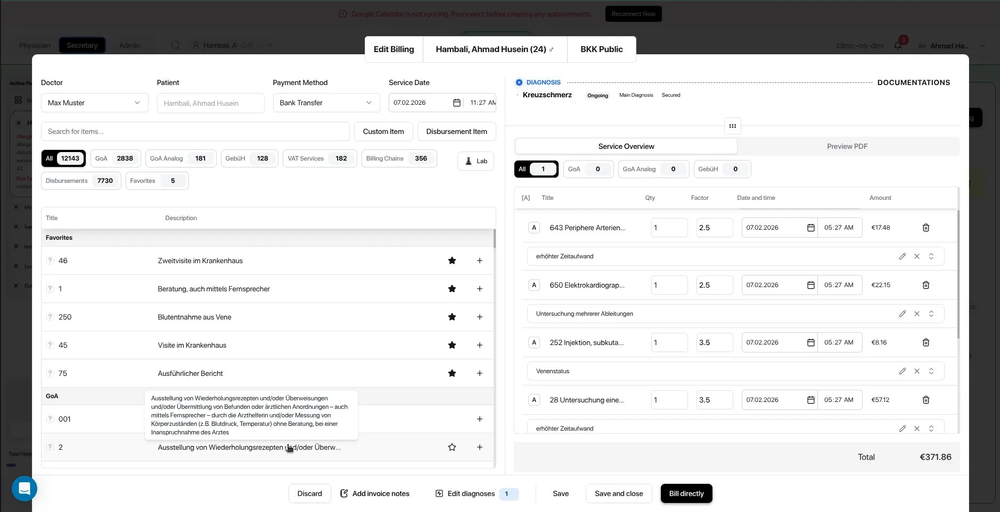

## Problem

- Medical teams often relied on fragmented tools for documentation, billing, lab submissions, insurance workflows, and patient data management.
- Manual forms and disconnected systems slowed clinical operations and increased the risk of data-entry errors.

## My Role

- Backend Engineer leading backend development across invoicing, billing workflows, third-party integrations, and backend architecture.
- Established backend standards around code reviews, testing, linting, formatting, and onboarding as the team scaled.

## What I Built

- Owned invoicing workflows and integrations with third-party billing, external lab, medication-data, insurance, and liquidation systems.
- Built an appointment-driven invoice lifecycle where draft invoices sync with appointment changes before being finalized into immutable invoices.
- Automated lab and insurance data submission, replacing manual multi-step forms with one-click clinician confirmation.
- Redesigned the plugin-based backend architecture to reduce coupling and improve modularity.

## Outcome

- Reduced manual clinical data-entry work and minimized submission errors.
- Improved backend modularity and reduced build time by 25%, accelerating CI/CD and team-wide feature delivery.
- Helped shorten doctor documentation workflows through AI-assisted drafts and OCR-based health record extraction.
- Streamlined patient, insurance, lab, and billing workflows across the wider ClinicOS platform.
