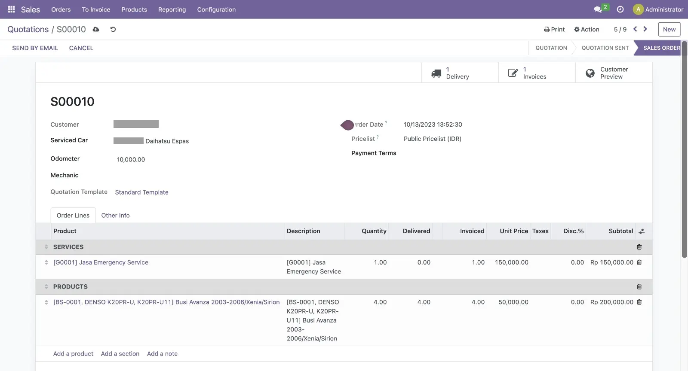

## Problem

- The company's existing tools could no longer support growing operational needs across service, inventory, customer management, and finance.
- Business data was spread across separate workflows, making it harder to track service history, sparepart stock, transactions, and operational reports in real time.
- The company needed a maintainable ERP-based system that could be handed off without requiring a dedicated in-house engineering team.

## What I Built

- Implemented an Odoo-based ERP system covering sales, service operations, customer management, inventory, and accounting workflows.
- Built custom addons and configurations to support Pitcar's car service business processes.
- Created an admin dashboard so leadership could monitor operations, service activity, inventory, and financial data from one place.
- Prepared documentation and a handoff plan for future maintenance by the client's internal or external maintainer.

## Outcome

- Replaced fragmented operational tools with a centralized ERP system for day-to-day business management.
- Enabled real-time visibility across service history, inventory, transactions, and reporting.
- Supported operations at around 400+ service units per month with a system that could be maintained after project handoff.
