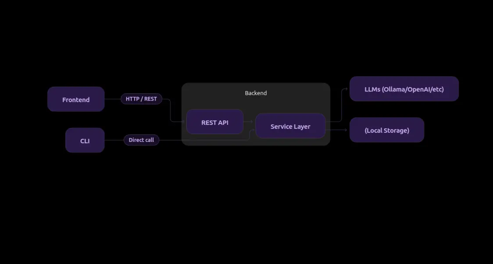
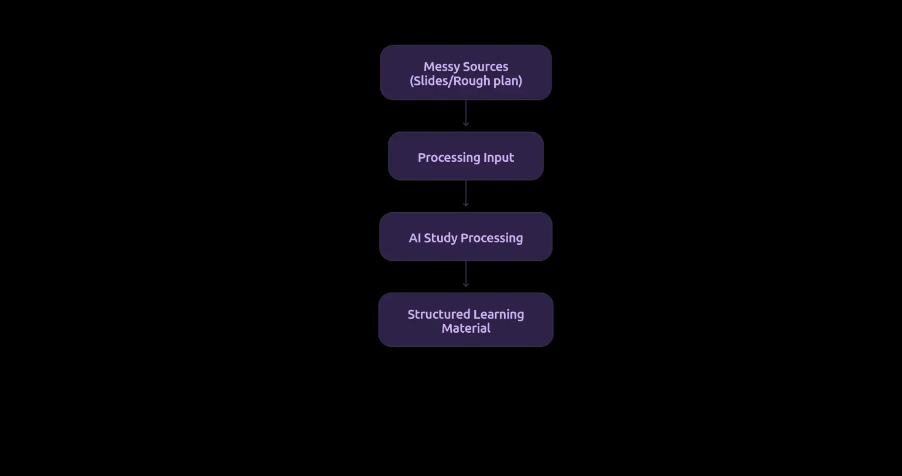
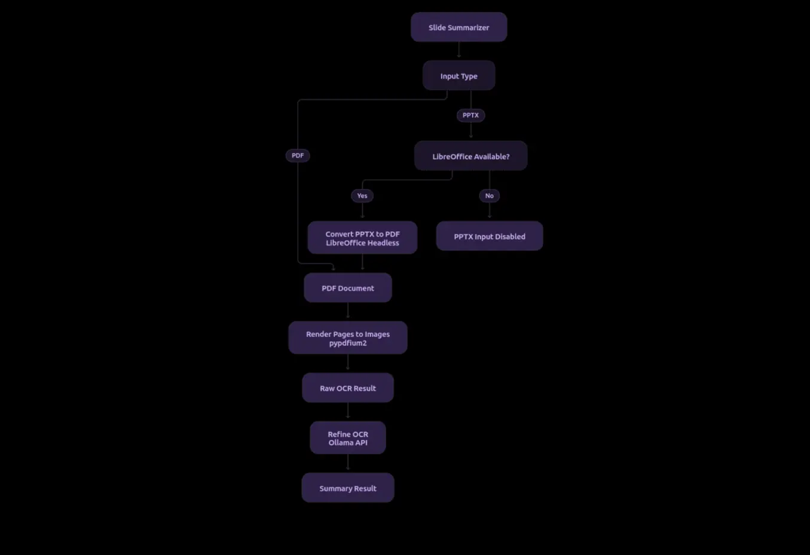
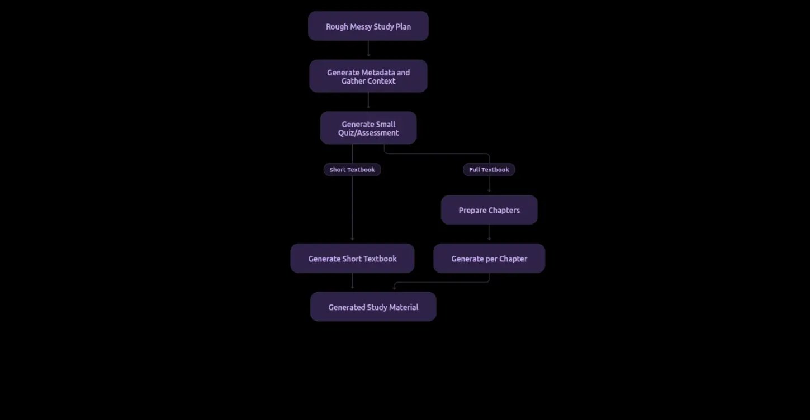

## Why I built it

- University lecture slides often compress complex topics into short summaries, leaving important context unexplained.
- Course material can also become outdated, while newer explanations and references are available online.
- I wanted a tool that could turn existing learning material into a personalized study plan instead of simply summarizing it.

## Constraints

- Designed primarily for personal use.
- Keep infrastructure simple and local-first.
- Minimize maintenance and external dependencies.
- Run efficiently with local LLMs, focusing on inference speed and resource usage.

## Design decisions

- File-based JSON storage instead of introducing a database for a single-user application.
- Polling the job status and progress to keep the API and client architecture simple.
- A single worker by default because local LLM inference is the primary bottleneck.
- Sanitize and validate output due to non-deterministic output from LLM.
- Cache OCR results so repeated processing of the same material does not require another vision-model invocation.

## Outcome

- A personal study tool that turns lecture slides and textbooks into structured learning material tailored to my study goals.
- Supports both slide-based and textbook-based learning workflows.
- Most importantly, it evolved from an experiment into a tool I can genuinely use in my own learning workflow.
